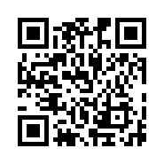
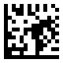
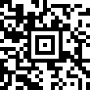
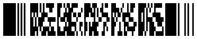
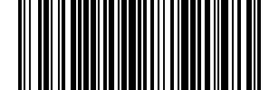
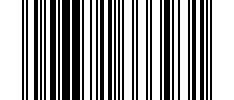
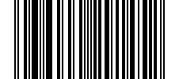
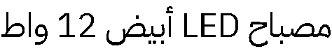
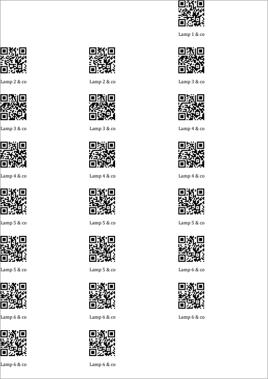

# qrbar

Generate barcodes and QR codes, and render sticker and label documents
(`.docx`, `.zpl` / `.prn`) from templates, for one item or thousands.

<p>
  
  
  
  
  
  
</p>

- **The template decides.** `{{ qr(item.url, size_mm=25) }}` picks the code
  type and its printed size; the data only carries values.
- **Same syntax, two outputs.** In a Word template a code becomes an image
  sized in mm; in a ZPL template it becomes the printer's native command
  (`^BQ`, `^BC`, `^BX`, ...).
- **Quantities built in.** A `qty` field per record: copies for documents,
  `^PQ` for ZPL.
- **Label sheets.** A4 3x8 and friends, with `skip` for partly used sheets.
- **Arabic in ZPL.** Shaped, right-to-left text drawn as a graphic, since
  label printers cannot join Arabic letters.
- **I/O-free.** Bytes and dicts in, bytes out: call it from a web view with an
  uploaded template and stream the result.
- **Typed.** Full type hints, `py.typed`, checked with `mypy --strict`.

Codes: `qr`, `code128`, `ean13`, `upca`, `datamatrix`, `pdf417`, `aztec`.

## Contents

- [Installation](#installation)
- [Quick start](#quick-start)
- [Barcode images](#barcode-images)
- [ZPL labels](#zpl-labels)
- [Arabic text in ZPL](#arabic-text-in-zpl)
- [Word (docx) templates](#word-docx-templates)
- [Label sheets](#label-sheets)
- [PDF](#pdf)
- [Data and quantities](#data-and-quantities)
- [Web apps](#web-apps)
- [Errors](#errors)
- [Reference](#reference)
- [Custom code types](#custom-code-types)
- [License](#license)

---

## Installation

```bash
pip install qrbar
```

```bash
uv add qrbar
```

| Need | Install |
|------|---------|
| Arabic text in ZPL | `pip install "qrbar[arabic]"` |
| PDF output | [LibreOffice](https://www.libreoffice.org) on the machine (`soffice`); no extra package |

Python 3.12 or newer. Everything else (Pillow, segno, python-barcode,
zxing-cpp, docxtpl, Jinja) installs as prebuilt wheels; no system libraries.

---

## Quick start

```python
from pathlib import Path

import qrbar

# one code as an image
Path("item.png").write_bytes(qrbar.render_code("qr", "https://example.com/item/42"))

# a ZPL label per record, ready for a Zebra printer
record = {
    "url": "https://example.com/1",
    "sku": "SKU-1",
    "ean": "400638133393",
    "name": "Lamp",
    "qty": 2,
}

zpl = qrbar.render(Path("label.zpl").read_bytes(), record)

# a Word document, one label per page
docx = qrbar.render(Path("label_paged.docx").read_bytes(), [{"sku": "SKU-1", "name": "Lamp"}])
```

The templates used in this README are in [`tests/fixtures/`](tests/fixtures).
The test suite runs every Python example here and checks each printed result
(except the FastAPI and Django ones).

---

## Barcode images

`render_code(name, payload, fmt="png", *, scale=4)` returns PNG or SVG bytes.
`scale` is PNG pixels per module (one QR square, or the narrowest bar).

```python
png = qrbar.render_code("qr", "https://example.com/item/42", scale=8)
svg = qrbar.render_code("datamatrix", "SKU-00042", "svg")

Path("qr.png").write_bytes(png)
Path("datamatrix.svg").write_bytes(svg)
```

Every code type:

| Name | Example payload | Image | Payload rules |
|------|-----------------|-------|---------------|
| `qr` | `"https://example.com/item/42"` |  | Any text, UTF-8 (Arabic works); error level M |
| `datamatrix` | `"SKU-00042"` |  | Any text, UTF-8; always square |
| `aztec` | `"https://example.com/item/42"` |  | Any text, UTF-8 |
| `pdf417` | `"SKU-00042 Lamp 12W"` |  | Any text, UTF-8 |
| `code128` | `"SKU-00042"` |  | ASCII only |
| `ean13` | `"400638133393"` |  | 12 digits (check digit added) or 13 (check digit verified) |
| `upca` | `"03600029145"` |  | 11 digits, or 12 with a correct check digit |

Linear codes are bars only; print any human-readable text yourself in the
template. A bad payload raises `PayloadError` before anything is drawn:

```python
from qrbar import PayloadError

try:
    qrbar.render_code("ean13", "4006381333932")
except PayloadError as error:
    print(error)  # ean13: invalid payload '4006381333932', wrong check digit, expected 1.
```

Validate without drawing, e.g. in a form:

```python
from qrbar import symbologies

symbologies.get("upca").validate("036000291452")  # passes silently
print(symbologies.names())  # ['aztec', 'code128', 'datamatrix', 'ean13', 'pdf417', 'qr', 'upca']
```

---

## ZPL labels

A ZPL template is **one label**, `^XA ... ^XZ`, with Jinja in it. Each record
renders it once as `item`. Positions (`^FO`) and fonts stay in your template;
qrbar fills in the codes. This is [`tests/fixtures/label_203dpi.zpl`](tests/fixtures/label_203dpi.zpl):

```text

^XA
^FO50,50{{ qr(item.url, size_mm=25) }}
^FO50,300{{ code128(item.sku, width_mm=40, height_mm=10) }}
^FO50,450{{ ean13(item.ean) }}
^FO50,600^A0N,30,30^FD{{ item.name }}^FS
^XZ
```

```python
template = Path("label.zpl").read_bytes()

items = [
    {
        "url": "https://example.com/1",
        "sku": "SKU-1",
        "ean": "400638133393",
        "name": "Lamp",
        "qty": 3,
    },
    {"url": "https://example.com/2", "sku": "SKU-2", "ean": "590123412345", "name": "Desk lamp"},
]

zpl = qrbar.render(template, items)

Path("labels.zpl").write_bytes(zpl)
print(zpl.decode().splitlines()[0:3])
# ['^XA^CI28', '^FO50,50^BQN,2,8^FH_^FDMA,https://example.com/1^FS', '^FO50,300^BY3^BCN,80,N,N,N,A^FH_^FDSKU-1^FS']
```

What qrbar adds and checks:

- `^CI28` after `^XA` (UTF-8) and `^PQ{qty}` before `^XZ`: the first record
  above is **one block printed 3 times**, not three blocks. Do not put `^PQ`
  in the template.
- Sizes in mm become dots using `dpi` (set it before the first code;
  default 203). For a 300 dpi printer: ``.
- Code payloads are hex-escaped (`^FH`), so `^`, `~` and `_` in data are safe.
- A plain `{{ item.name }}` containing `^` or `~` is rejected
  (`ValidationError`), so data cannot inject ZPL commands. Use
  `{{ text(item.name) }}` for text that may contain them.
- A missing field (`item.typo`) raises an error naming the record, instead
  of printing an empty field.

### One block per record

`mode="per_item"` returns a list, e.g. to send records to different printers
or store them separately:

```python
blocks = qrbar.render(template, items, mode="per_item")

for index, block in enumerate(blocks):
    Path(f"label-{index}.zpl").write_bytes(block)
```

### Any code by name

`barcode(name, data, ...)` picks the type from data or a variable:

```python
row = {"kind": "datamatrix", "code": "SKU-7", "qty": 1}

zpl = qrbar.render(b"^XA^FO20,20{{ barcode(item.kind, item.code, size_mm=12) }}^XZ", row)
print(zpl.decode())  # ^XA^CI28^FO20,20^BXN,8,200^FH_^FDSKU-7^FS^PQ1^XZ
```

Integers work as payloads too: `{{ ean13(item.ean) }}` with `"ean": 400638133393`.

---

## Arabic text in ZPL

Label printers print Arabic letters unjoined and left to right. `text()`
shapes the text, orders it right to left and sends it as a `^GF` graphic.
Latin-only text stays a native, sharp `^A0` field.



```bash
pip install "qrbar[arabic]"
```

```python
label = (
    "^XA"
    "^FO20,20{{ text(item.name_ar, size_mm=5) }}"
    "^FO20,80{{ text(item.name_en, size_mm=4) }}"
    "^FO20,140{{ qr(item.url, size_mm=15) }}"
    "^XZ"
).encode()

record = {
    "name_ar": "مصباح LED أبيض 12 واط",
    "name_en": "LED lamp, white, 12 W",
    "url": "https://example.com/7",
}

zpl = qrbar.render(label, record).decode()

print(zpl[:24])  # ^XA^CI28^FO20,20^GFA,...
print("^A0N,32,32^FH_^FDLED lamp, white, 12 W^FS" in zpl)  # True
```

`size_mm` is the font size. The default font is IBM Plex Sans Arabic
(bundled, OFL); it covers Latin too, so mixed text like `"مصباح LED"` draws
in one font. Use your own with `font=`:

```python
# needs: your font file
zpl = qrbar.render(label, record, font=Path("NotoNaskhArabic-Regular.ttf").read_bytes())
```

---

## Word (docx) templates

Write the template in Word with the same functions; codes become inline
images sized in mm. The template sees your data with
[docxtpl](https://docxtpl.readthedocs.io) syntax (`` for whole
paragraphs, `` for table rows).

Sizes are the **code itself**, without its white margin: leave a few mm of
space around each code. Values from your data are XML-escaped, so `&` and `<`
are safe.

### One label per page (`paged`, the default)

[`tests/fixtures/label_paged.docx`](tests/fixtures/label_paged.docx) is a
60 x 40 mm page containing:

```text

{{ code128(item.sku, width_mm=50, height_mm=12) }}
{{ item.name }}

<page break>


```

```python
labels = [
    {"sku": "SKU-1", "name": "Lamp", "qty": 2},
    {"sku": "SKU-2", "name": "Desk lamp & shade"},
]

docx = qrbar.render(Path("label_paged.docx").read_bytes(), labels)  # 3 pages: SKU-1, SKU-1, SKU-2

Path("labels.docx").write_bytes(docx)
```

Copies come grouped (A, A, B). `collate="interleaved"` gives A, B, A, e.g.
to hand out one of each first:

```python
docx = qrbar.render(Path("label_paged.docx").read_bytes(), labels, collate="interleaved")
```

### One document per record (`per_item`)

```python
docs = qrbar.render(Path("label_paged.docx").read_bytes(), labels, mode="per_item")

for record, docx in zip(labels, docs, strict=True):
    Path(f"{record['sku']}.docx").write_bytes(docx)
```

Each document sees `item` (the record) and `items` (its copies), so the same
template works in both modes.

### Sizes in docx

| Call | Size |
|------|------|
| `{{ qr(item.url) }}` | 0.25 mm per module (a 25-module QR is 6.25 mm) |
| `{{ qr(item.url, size_mm=20) }}` | 20 x 20 mm |
| `{{ code128(item.sku, width_mm=50) }}` | 50 mm wide, keeps its ratio |
| `{{ code128(item.sku, width_mm=50, height_mm=12) }}` | 50 x 12 mm |

Images are drawn at 600 dpi or more for their printed size, so they stay
sharp when Word prints them.

---

## Label sheets

For sheets like A4 3 x 8, Word has no "repeat this cell" feature, so qrbar
splits the copies into `pages -> rows -> cells` and the template loops over
them. A cell is a record's data, or `None` for an empty position.



[`tests/fixtures/sheet_a4_3x8.docx`](tests/fixtures/sheet_a4_3x8.docx) is an
A4 page with zero margins and one table row of three 70 x 37 mm cells:

```text

┌───────────────────────────┬─────────────────────────┬─────────────────────────┐
│                                                         │
├───────────────────────────┼─────────────────────────┼─────────────────────────┤
│            │  ...     │  ...     │
│ {{ qr(row[0].url,         │                         │                         │
│       size_mm=20) }}      │                         │                         │
│                │                         │                         │
│            │                         │                         │
│ {{ row[0].name }}         │                         │                         │
│                │                         │                         │
├───────────────────────────┼─────────────────────────┼─────────────────────────┤
│                                                                  │
└───────────────────────────┴─────────────────────────┴─────────────────────────┘
 <page break> 

```

Tips for the Word side: fix the row height ("exactly 37 mm"), and keep the
paragraphs between tables at 1 pt so a full sheet does not spill a blank page.

```python
from qrbar import SheetOptions, SheetSpec

products = [{"url": f"https://example.com/{n}", "name": f"Lamp {n}", "qty": n} for n in range(1, 7)]

docx = qrbar.render(
    Path("sheet_a4_3x8.docx").read_bytes(),
    products,
    mode="sheet",
    sheet=SheetSpec(rows=8, cols=3),
    options=SheetOptions(skip=2),  # the first two stickers were already used
)

Path("sheet.docx").write_bytes(docx)  # the preview above
```

### Sheet options

| Option | Effect |
|--------|--------|
| `skip=5` | Leave the first 5 positions empty, to reuse a partly used sheet |
| `fill_last=True` | Pad the last sheet with `None` cells |
| `new_page_per_record=True` | Start each record's copies on a fresh sheet |
| `collate="interleaved"` | Order copies A, B, A instead of A, A, B |

What the template receives, for 2 x A and 1 x B on a 2 x 2 sheet:

```python
from qrbar.layout import layout_sheet
from qrbar.records import parse_records


def show(options):
    pages = layout_sheet(
        parse_records([{"sku": "A", "qty": 2}, {"sku": "B"}]), SheetSpec(2, 2), options
    )
    return [
        [[cell.data["sku"] if cell else None for cell in row] for row in page] for page in pages
    ]


print(show(SheetOptions()))  # [[['A', 'A'], ['B', None]]]
print(show(SheetOptions(skip=1)))  # [[[None, 'A'], ['A', 'B']]]
print(show(SheetOptions(collate="interleaved")))  # [[['A', 'B'], ['A', None]]]
print(show(SheetOptions(new_page_per_record=True)))  # [[['A', 'A']], [['B', None]]]
```

Rows are always padded to the full width, so Word tables stay even.

---

## PDF

Convert any rendered docx with LibreOffice (headless, in a temp folder: the
only part of qrbar that touches files or runs a process):

```python
# needs: LibreOffice
pdf = qrbar.docx_to_pdf(docx)

Path("sheet.pdf").write_bytes(pdf)

# one PDF per record
pdfs = [qrbar.docx_to_pdf(doc) for doc in docs]
```

- LibreOffice is found on `PATH` or in its default install folder; otherwise
  pass `soffice="/opt/libreoffice/program/soffice"`.
- `timeout` (default 120 s) stops a stuck conversion and kills its processes.
- Each call uses its own LibreOffice profile, so parallel conversions are safe.
- Failures raise `ConversionError`, separate from data errors.

---

## Data and quantities

`data` is one dict or a list of dicts (any mappings). The quantity field:

| Value | Copies |
|-------|--------|
| missing, `None`, `""` | 1 |
| `0` | none, the record is skipped |
| `3`, `3.0`, `"3"`, `" 3 "` | 3 |
| `-1`, `2.5`, `"abc"`, `True` | `QuantityError` naming the record |

### From a CSV file

```csv
sku,name,url,qty
SKU-1,Lamp,https://example.com/1,3
SKU-2,Desk lamp,https://example.com/2,
SKU-3,Discontinued,https://example.com/3,0
```

```python
import csv

with open("items.csv", newline="", encoding="utf-8") as file:
    rows = list(csv.DictReader(file))  # qty values are strings, and that is fine

docx = qrbar.render(Path("label_paged.docx").read_bytes(), rows)  # 3 + 1 + 0 labels
```

### Another quantity field, and a copy limit

```python
orders = [{"sku": "SKU-1", "name": "Lamp", "copies": 4}]

docx = qrbar.render(Path("label_paged.docx").read_bytes(), orders, qty_field="copies")
```

`max_copies` (default 10,000 per call) rejects a huge quantity, e.g. a typo
in a web form, before anything is rendered. Raise it or pass
`max_copies=None` for big trusted jobs:

```python
try:
    qrbar.render(Path("label_paged.docx").read_bytes(), {"sku": "X", "name": "X", "qty": 50_000})
except qrbar.ValidationError as error:
    print(error)  # 50000 copies requested, more than max_copies=10000.
```

---

## Web apps

qrbar takes bytes and returns bytes, so templates can come from uploads or a
database and results stream straight back.

FastAPI:

```python
# needs: fastapi
import json

from fastapi import FastAPI, Form, HTTPException, UploadFile
from fastapi.responses import Response

import qrbar

app = FastAPI()


@app.post("/labels")
async def labels(template: UploadFile, items: str = Form()) -> Response:
    """Multipart form: the template file, and the records as a JSON string."""
    try:
        result = qrbar.render(await template.read(), json.loads(items))
    except qrbar.ValidationError as error:  # bad data, template or arguments
        raise HTTPException(422, str(error)) from error

    is_docx = result.startswith(b"PK")
    media = (
        "application/vnd.openxmlformats-officedocument.wordprocessingml.document"
        if is_docx
        else "text/plain"
    )

    return Response(result, media_type=media)
```

Django:

```python
# needs: django
from django.http import HttpResponse

import qrbar

from .models import LabelTemplate, Product


def sheet(request, template_id):
    template = LabelTemplate.objects.get(pk=template_id)
    products = Product.objects.values("sku", "name", "url", "qty")

    docx = qrbar.render(
        template.file.read(),
        list(products),
        mode="sheet",
        sheet=qrbar.SheetSpec(rows=8, cols=3),
        options=qrbar.SheetOptions(skip=int(request.GET.get("skip", 0))),
    )

    response = HttpResponse(
        docx, content_type="application/vnd.openxmlformats-officedocument.wordprocessingml.document"
    )
    response["Content-Disposition"] = 'attachment; filename="labels.docx"'

    return response
```

---

## Errors

Every error derives from `QrbarError`; data and template problems are also
`ValueError`s.

```text
QrbarError
├── ValidationError (ValueError)    bad data or arguments
│   ├── QuantityError               a record's qty is invalid
│   ├── PayloadError                a code cannot encode its data
│   ├── TemplateError               the template cannot be read or parsed
│   └── RecordError                 rendering one record failed (.index, .error)
├── UnknownSymbologyError (LookupError)
├── SymbologyAlreadyRegisteredError
└── ConversionError                 LibreOffice is missing or failed
```

`RecordError` tells you which record broke and why, e.g. to point at a row in
an uploaded spreadsheet:

```python
bad = [
    {"url": "u", "sku": "SKU-1", "ean": "400638133393", "name": "Lamp"},
    {"url": "u", "sku": "SKU-2", "ean": "12345", "name": "Shade"},
]

try:
    qrbar.render(Path("label.zpl").read_bytes(), bad)
except qrbar.RecordError as error:
    print(error.index)  # 1
    print(error)  # Record 1: ean13: invalid payload '12345', must be 12 or 13 digits.
```

In docx `sheet` and `paged` modes all records render together, so errors there
do not carry a record index; `per_item` and ZPL do.

---

## Reference

### `render`

```text
render(
    template: bytes,                     # .docx or ZPL bytes
    data: Mapping | Sequence[Mapping],   # one record or many
    *,
    mode="paged",                        # "paged" | "sheet" | "per_item"
    kind=None,                           # "docx" | "zpl"; None sniffs (zip = docx)
    qty_field="qty",
    sheet=None,                          # SheetSpec(rows, cols), required for "sheet"
    options=None,                        # SheetOptions, "sheet" only
    collate=None,                        # "grouped" | "interleaved", docx "paged"/"sheet"
    max_copies=10_000,                   # None turns the limit off
    font=None,                           # TTF/OTF bytes for Arabic text(), ZPL only
) -> bytes | list[bytes]                 # list[bytes] for "per_item"
```

| Mode | docx | ZPL |
|------|------|-----|
| `paged` | One document, one label per copy | All blocks joined |
| `sheet` | One document of label sheets | Not available |
| `per_item` | One document per record | One block per record |

Options that do not apply (e.g. `sheet=` with `paged`, `collate=` with ZPL)
raise `ValidationError` instead of being ignored.

### Template functions

| Function | docx | ZPL |
|----------|------|-----|
| `qr(data, ...)` | Image | `^BQ` |
| `code128(data, ...)` | Image | `^BC` |
| `ean13(data, ...)` | Image | `^BE` |
| `upca(data, ...)` | Image | `^BU` |
| `datamatrix(data, ...)` | Image | `^BX` |
| `pdf417(data, ...)` | Image | `^B7` |
| `aztec(data, ...)` | Image | `^BO` |
| `barcode(name, data, ...)` | Any of the above by name | |
| `text(value, size_mm=3)` | | `^A0`, or `^GF` for Arabic |

Code options: `size_mm` (width and height), `width_mm`, `height_mm`. Square
codes use the width. Without a width a module is about 0.25 mm; linear codes
default to 50 modules tall. In ZPL the module is whole dots (1 to 10), so the
printed width is the largest that fits.

---

## Custom code types

A code type is any object with the `qrbar.symbologies.Symbology` protocol:
`name`, `validate`, `to_png`, `to_svg`, `module_size` and `to_zpl`. Register
it and it works in `render_code` and in every template. A Code 39 built on
zxing-cpp (installed with qrbar):

```python
import io

import zxingcpp
from PIL import Image

from qrbar import PayloadError, symbologies


class Code39:
    name = "code39"

    def _make(self, payload: str) -> zxingcpp.Barcode:
        try:
            return zxingcpp.create_barcode(payload, zxingcpp.BarcodeFormat.Code39)
        except ValueError as error:
            raise PayloadError(self.name, payload, str(error)) from None

    def validate(self, payload: str) -> None:
        self._make(payload)

    def to_png(self, payload: str, *, scale: int = 4, quiet_zone: bool = True) -> bytes:
        view = memoryview(self._make(payload).to_image(scale=scale, add_quiet_zones=quiet_zone))
        height, width = view.shape or (0, 0)
        buffer = io.BytesIO()
        Image.frombytes("L", (width, height), view.tobytes()).save(buffer, "PNG")
        return buffer.getvalue()

    def to_svg(self, payload: str) -> bytes:
        return self._make(payload).to_svg().encode()

    def module_size(self, payload: str) -> tuple[int, int]:
        height, width = memoryview(self._make(payload).to_image(add_quiet_zones=False)).shape or (
            0,
            0,
        )
        return width, height

    def to_zpl(self, payload: str, *, module: int, height: int) -> str:
        self.validate(payload)
        return f"^BY{module}^B3N,N,{height},N,N^FD{payload}^FS"


symbologies.register(Code39())

Path("code39.png").write_bytes(qrbar.render_code("code39", "LAMP-12W"))

zpl = qrbar.render(b"^XA^FO20,20{{ code39(item.sku, height_mm=10) }}^XZ", {"sku": "LAMP-12W"})
print(zpl.decode())  # ^XA^CI28^FO20,20^BY2^B3N,N,80,N,N^FDLAMP-12W^FS^PQ1^XZ
```

`register(..., replace=True)` swaps out a built-in handler, e.g. to change
the QR error correction level.

---

## License

GPL-3.0-or-later. The bundled IBM Plex Sans Arabic font is under the SIL Open
Font License 1.1 ([`src/qrbar/fonts/OFL.txt`](src/qrbar/fonts/OFL.txt)).
