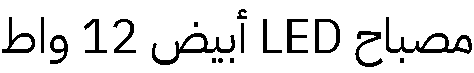

# Arabic text in ZPL

Label printers print Arabic letters unjoined and left to right. `text()`
shapes the text, orders it right to left and sends it as a `^GF` graphic.
Latin-only text stays a native, sharp `^A0` field.

{ height="40" }

It needs the `arabic` extra:

```bash
pip install "qrbar[arabic]"
```

```python
import qrbar

label = (
    "^XA"
    "^FO20,20{{ text(item.name_ar, size_mm=5) }}"
    "^FO20,80{{ text(item.name_en, size_mm=4) }}"
    "^FO20,140{{ qr(item.url, size_mm=15) }}"
    "^XZ"
).encode()

record = {
    "name_ar": "مصباح LED أبيض 12 واط",
    "name_en": "LED lamp, white, 12 W",
    "url": "https://example.com/7",
}

zpl = qrbar.render(label, record).decode()

print(zpl[:24])  # ^XA^CI28^FO20,20^GFA,...
print("^A0N,32,32^FH_^FDLED lamp, white, 12 W^FS" in zpl)  # True
```

`size_mm` is the font size (default 3 mm), converted to dots with the
template's `dpi`. `text()` also escapes `^`, `~` and `_`, so use it for any
value that may contain them.

## Fonts

The default font is IBM Plex Sans Arabic (bundled, OFL); it covers Latin too,
so mixed text like `"مصباح LED"` draws in one font. Use your own TrueType or
OpenType font with `font=`:

```python
from pathlib import Path

zpl = qrbar.render(label, record, font=Path("NotoNaskhArabic-Regular.ttf").read_bytes())
```

`font=` only applies to ZPL templates; passing it with a docx raises
`ValidationError`, since Word uses its own fonts.
