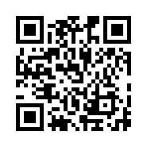
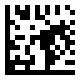
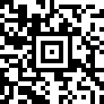
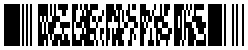
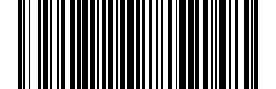
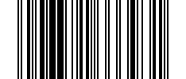
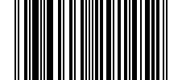

# Barcode images

`render_code(name, payload, fmt="png", *, scale=4)` returns PNG or SVG bytes.
`scale` is PNG pixels per module (one QR square, or the narrowest bar).

```python
from pathlib import Path

import qrbar

png = qrbar.render_code("qr", "https://example.com/item/42", scale=8)
svg = qrbar.render_code("datamatrix", "SKU-00042", "svg")

Path("qr.png").write_bytes(png)
Path("datamatrix.svg").write_bytes(svg)
```

An unknown format raises `ValidationError`; an unknown code name raises
`UnknownSymbologyError` listing the names that exist.

## Code types

| Name | Example payload | Image | Payload rules |
|------|-----------------|-------|---------------|
| `qr` | `"https://example.com/item/42"` | { height="60" } | Any text, UTF-8 (Arabic works); error level M |
| `datamatrix` | `"SKU-00042"` | { height="60" } | Any text, UTF-8; always square |
| `aztec` | `"https://example.com/item/42"` | { height="60" } | Any text, UTF-8 |
| `pdf417` | `"SKU-00042 Lamp 12W"` | { height="40" } | Any text, UTF-8 |
| `code128` | `"SKU-00042"` | { height="40" } | ASCII only |
| `ean13` | `"400638133393"` | { height="40" } | 12 digits (check digit added) or 13 (check digit verified) |
| `upca` | `"03600029145"` | { height="40" } | 11 digits, or 12 with a correct check digit |

Linear codes (`code128`, `ean13`, `upca`) are bars only; print any
human-readable text yourself in the template. Payloads must be non-empty
strings; in templates, integers are accepted too and turned into strings.

## Bad payloads

A bad payload raises `PayloadError` before anything is drawn:

```python
from qrbar import PayloadError

try:
    qrbar.render_code("ean13", "4006381333932")
except PayloadError as error:
    print(error)  # ean13: invalid payload '4006381333932', wrong check digit, expected 1.
```

`PayloadError` carries `.symbology` and `.payload`, and is a `ValueError`.

## Validate without drawing

Look a code type up in the registry and call `validate`, e.g. in a form:

```python
from qrbar import symbologies

symbologies.get("upca").validate("036000291452")  # passes silently
print(symbologies.names())  # ['aztec', 'code128', 'datamatrix', 'ean13', 'pdf417', 'qr', 'upca']
```

A handler also gives you `to_png(payload, *, scale=4, quiet_zone=True)`
(`quiet_zone=False` crops the white margin), `to_svg(payload)` and
`module_size(payload)`, the code's `(width, height)` in modules. See
[Custom code types](custom-symbologies.md) for the full protocol.

The images on this page are built by `docs/make_images.py`
(`uv run python docs/make_images.py`).
