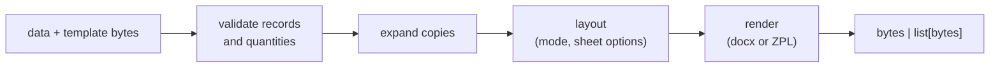

# User guide

qrbar has two entry points:

- [`render_code(name, payload)`](images.md) draws one code as PNG or SVG bytes.
- [`render(template, data)`](../reference/api.md#render) fills a docx or ZPL
  template with one record or many, and returns `bytes` (or `list[bytes]`).

Every call to `render` runs the same pipeline:

The template type is sniffed from its bytes (a zip is docx, anything else is
ZPL), or set with `kind="docx"` / `kind="zpl"`. Records are validated before
anything is drawn, so a bad quantity or an option that does not apply fails
fast with a `ValidationError`.

## Pages

| Page | What it covers |
|------|----------------|
| [Barcode images](images.md) | `render_code`, every code type and its payload rules, validating without drawing |
| [ZPL labels](zpl.md) | ZPL templates, `^PQ` quantities, dpi, escaping, one block per record |
| [Arabic text in ZPL](arabic.md) | `text()`, shaped right-to-left text as a `^GF` graphic, custom fonts |
| [Word (docx) templates](docx.md) | `paged` and `per_item` modes, code sizes in mm, collation |
| [Label sheets](sheets.md) | `mode="sheet"`, `SheetSpec`, `SheetOptions` and what the template receives |
| [Data and quantities](data.md) | records, the `qty` field, `qty_field`, `max_copies` |
| [PDF](pdf.md) | converting a rendered docx with LibreOffice |
| [Custom code types](custom-symbologies.md) | the `Symbology` protocol and `register` |

## Output modes

| Mode | docx | ZPL |
|------|------|-----|
| `paged` (default) | One document, one label per copy | All blocks joined |
| `sheet` | One document of label sheets | Not available |
| `per_item` | One document per record | One block per record |
