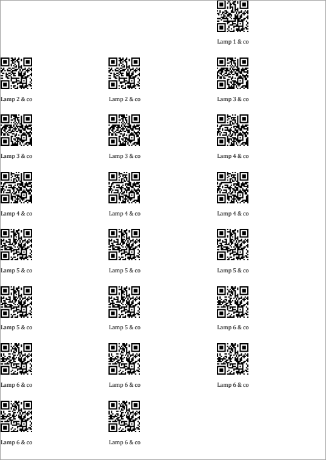

# Label sheets

For sheets like A4 3 x 8, Word has no "repeat this cell" feature, so qrbar
splits the copies into `pages -> rows -> cells` and the template loops over
them. A cell is a record's data, or `None` for an empty position.

{ width="280" }

[`tests/fixtures/sheet_a4_3x8.docx`](https://github.com/aaltatan/qrbar/blob/main/tests/fixtures/sheet_a4_3x8.docx)
is an A4 page with zero margins and one table row of three 70 x 37 mm cells:

```text

┌───────────────────────────┬─────────────────────────┬─────────────────────────┐
│                                                         │
├───────────────────────────┼─────────────────────────┼─────────────────────────┤
│            │  ...     │  ...     │
│ {{ qr(row[0].url,         │                         │                         │
│       size_mm=20) }}      │                         │                         │
│                │                         │                         │
│            │                         │                         │
│ {{ row[0].name }}         │                         │                         │
│                │                         │                         │
├───────────────────────────┼─────────────────────────┼─────────────────────────┤
│                                                                  │
└───────────────────────────┴─────────────────────────┴─────────────────────────┘
 <page break> 

```

!!! tip "The Word side"
    Fix the row height ("exactly 37 mm"), and keep the paragraphs between
    tables at 1 pt so a full sheet does not spill a blank page.

```python
from pathlib import Path

import qrbar
from qrbar import SheetOptions, SheetSpec

products = [{"url": f"https://example.com/{n}", "name": f"Lamp {n}", "qty": n} for n in range(1, 7)]

docx = qrbar.render(
    Path("sheet_a4_3x8.docx").read_bytes(),
    products,
    mode="sheet",
    sheet=SheetSpec(rows=8, cols=3),
    options=SheetOptions(skip=2),  # the first two stickers were already used
)

Path("sheet.docx").write_bytes(docx)  # the preview above
```

`mode="sheet"` needs `sheet=SheetSpec(rows, cols)` and works with docx only.

## Sheet options

| Option | Effect |
|--------|--------|
| `skip=5` | Leave the first 5 positions empty, to reuse a partly used sheet (must be less than the cells on a sheet) |
| `fill_last=True` | Pad the last sheet with `None` cells |
| `new_page_per_record=True` | Start each record's copies on a fresh sheet |
| `collate="interleaved"` | Order copies A, B, A instead of A, A, B |

`new_page_per_record` keeps a record's copies together, so combining it with
`collate="interleaved"` raises `ValidationError`. A `collate=` argument to
`render` overrides `options.collate`.

## What the template receives

For 2 x A and 1 x B on a 2 x 2 sheet:

```python
from qrbar.layout import layout_sheet
from qrbar.records import parse_records


def show(options):
    pages = layout_sheet(
        parse_records([{"sku": "A", "qty": 2}, {"sku": "B"}]), SheetSpec(2, 2), options
    )
    return [
        [[cell.data["sku"] if cell else None for cell in row] for row in page] for page in pages
    ]


print(show(SheetOptions()))  # [[['A', 'A'], ['B', None]]]
print(show(SheetOptions(skip=1)))  # [[[None, 'A'], ['A', 'B']]]
print(show(SheetOptions(collate="interleaved")))  # [[['A', 'B'], ['A', None]]]
print(show(SheetOptions(new_page_per_record=True)))  # [[['A', 'A']], [['B', None]]]
```

Rows are always padded to the full width, so Word tables stay even. No
records gives no pages.
