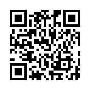
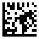
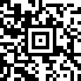
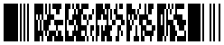
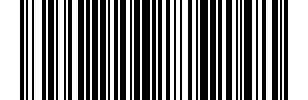
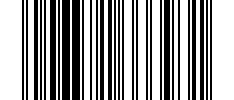

# qrbar

**Barcodes, QR codes, and sticker and label documents from templates, for one item or thousands.**

qrbar draws a single code as an image, or fills a Word (`.docx`) or ZPL
(`.zpl` / `.prn`) label template with your records. The template says which
code to draw and how big; the data only carries values.

<p markdown>
{ height="96" }
{ height="96" }
{ height="96" }
{ height="96" }
{ height="96" }
{ height="96" }
</p>

## A first taste

```python
from pathlib import Path

import qrbar

# one code as an image
Path("item.png").write_bytes(qrbar.render_code("qr", "https://example.com/item/42"))

# a ZPL label per record, ready for a Zebra printer
record = {
    "url": "https://example.com/1",
    "sku": "SKU-1",
    "ean": "400638133393",
    "name": "Lamp",
    "qty": 2,
}

zpl = qrbar.render(Path("label.zpl").read_bytes(), record)

# a Word document, one label per page
docx = qrbar.render(Path("label_paged.docx").read_bytes(), [{"sku": "SKU-1", "name": "Lamp"}])
```

The template `label.zpl` is one label with Jinja in it:

```text

^XA
^FO50,50{{ qr(item.url, size_mm=25) }}
^FO50,300{{ code128(item.sku, width_mm=40, height_mm=10) }}
^FO50,450{{ ean13(item.ean) }}
^FO50,600^A0N,30,30^FD{{ item.name }}^FS
^XZ
```

The templates used in these docs are in the repository's
[`tests/fixtures/`](https://github.com/aaltatan/qrbar/tree/main/tests/fixtures).

## Why qrbar

- **The template decides.** `{{ qr(item.url, size_mm=25) }}` picks the code
  type and its printed size; the data only carries values.
- **Same syntax, two outputs.** In a Word template a code becomes an image
  sized in mm; in a ZPL template it becomes the printer's native command
  (`^BQ`, `^BC`, `^BX`, ...).
- **Quantities built in.** A `qty` field per record: copies for documents,
  `^PQ` for ZPL.
- **Label sheets.** A4 3x8 and friends, with `skip` for partly used sheets.
- **Arabic in ZPL.** Shaped, right-to-left text drawn as a graphic, since
  label printers cannot join Arabic letters.
- **I/O-free.** Bytes and dicts in, bytes out: call it from a web view with an
  uploaded template and stream the result.
- **Typed.** Full type hints, `py.typed`, checked with `mypy --strict`.

Codes: `qr`, `code128`, `ean13`, `upca`, `datamatrix`, `pdf417`, `aztec`, and
[your own](guide/custom-symbologies.md).

## Where to next

<div class="grid cards" markdown>

- **[Installation](install.md)**: the package, the Arabic extra, and LibreOffice for PDF.
- **[User guide](guide/index.md)**: images, ZPL, Word, label sheets, quantities.
- **[Recipes](recipes.md)**: CSV files, web apps, one file per record.
- **[Reference](reference/index.md)**: every public name, template function and exception.

</div>
